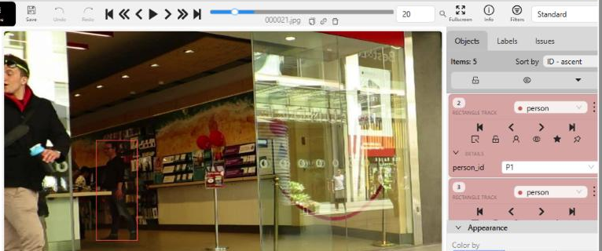
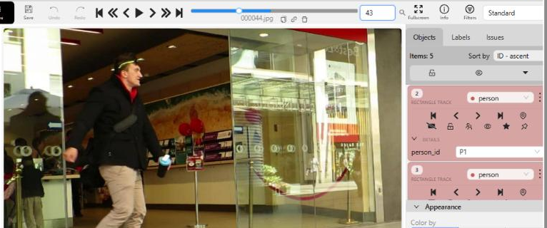
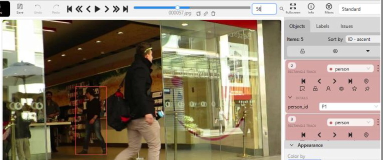

# Báo cáo cá nhân — NgoNgocTruong-2A202603329

Đoạn video: MOT17-09, 150 frame (frame 1–150), nguồn MOTChallenge, giấy phép CC BY-NC-SA 3.0.

Số frame trong báo cáo ghi theo CVAT (0–149).

## 0. Thông tin học viên

- Họ tên: Ngô Ngọc Trường
- MSSV: 2A202603329
- Mã đề (A/B/C): B
- Email: Ngô Ngọc Trường
- Link repository: https://github.com/nnt7923/K5-L2B-2A202603329-NgoNgocTruong-MOTTracking
- Giờ bắt đầu: 16:30
- Giờ kết thúc: 18h40

## 1. Xem trước đoạn video (CP0)

| Mã | Frame xuất hiện | Frame cuối thấy được | Rẽ / dừng / đổi tốc độ ở frame | Bị che ở frame | Ghi chú |
|---|---|---|---|---|---|
| P1 | 0 | 149 | Đi sang phải đến khoảng 105, sau đó gần như đứng tại chỗ | 0–9 (khuất nhẹ sau cột cửa), 27–54 (người đi ngang che), khuất hẳn ở 43 | Nam áo tối, đứng trong cửa hàng sau lớp kính |
| P2 | 0 | 149 | Đi thẳng về phía camera, box to dần liên tục (cao 363 px ở frame 0, 846 px ở frame 149) | Không | Nữ áo khoác xanh lá, đeo túi đen; đi ngang trước P4, P5 |
| P3 | 0 | 149 | Đi thẳng về phía camera, box to dần liên tục | Không | Nam áo xanh dương, mũ trắng; frame 0–60 bị mép phải khung hình cắt một phần |
| P4 | 0 | 147 | Di chuyển nhẹ sang phải ở 0–40, sau đó đứng yên | 105–149 (P2, P3 đi ngang che); khuất hẳn 111–129, 132–134, 148–149 | Em bé, đứng cạnh P5 trước cửa hàng |
| P5 | 0 | 138 | Di chuyển nhẹ sang phải ở 0–40, sau đó đứng yên | 91–149 (P2, P3 đi ngang che); khuất hẳn 107–122, 139–149 | Người lớn áo hồng đứng cạnh P4 |

## 2. Keyframe và thời gian (CP1, CP4)

Số keyframe lấy từ kết quả `src/check_submission.py`. Thứ tự track trong file xuất: track 0 = P2, track 1 = P1, track 2 = P3, track 3 = P4, track 4 = P5 (trong `gt.txt` là ID 1 = P2, 2 = P1, 3 = P3, 4 = P4, 5 = P5).

| Mã | Số keyframe | Keyframe ở frame | Số frame có mặt | Keyframe / 100 frame | Thời gian (phút) | Chỗ khó |
|---|---|---|---|---|---|---|
| P1 | 32 | 0, 5, 10, 15, 20, 25, 27, 30, 42, 44, 50, 55, 60, 65, 70, 75, 80, 85, 88, 90, 95, 103, 104, 105, 110, 115, 120, 125, 135, 145, 146, 149 | 149 | 21,5 | 35 | Đoạn 27–54 bị người đi ngang che, phải ước lượng box toàn thân |
| P2 | 33 | 0, 10, 14, 21, 27, 32, 36, 43, 51, 56, 58, 61, 62, 66, 68, 73, 77, 79, 84, 88, 90, 95, 100, 105, 110, 115, 120, 125, 127, 130, 135, 143, 149 | 150 | 22,0 | 25| Lại gần camera nên kích thước box đổi liên tục, tay chân vung làm mép box thay đổi |
| P3 | 25 | 0, 10, 15, 20, 25, 30, 35, 45, 55, 65, 70, 80, 85, 89, 90, 100, 106, 115, 120, 126, 129, 135, 139, 145, 149 | 150 | 16,7 | 25| Bị mép phải khung hình cắt ở đầu đoạn; box to dần khi lại gần |
| P4 | 17 | 0, 5, 10, 15, 20, 25, 40, 50, 60, 105, 110, 130, 131, 135, 139, 142, 147 | 126 | 13,5 | 20 | Người nhỏ, bị P2 và P3 che nhiều lần ở cuối đoạn |
| P5 | 14 | 0, 5, 10, 15, 20, 25, 30, 35, 40, 65, 91, 106, 123, 138 | 123 | 11,4 | 25 | Bị P2 và P3 che ở cuối đoạn |
| **Tổng** | 121 | | 698 | 17,3 | 130 | |

Keyframe / 100 frame của cả bài = tổng keyframe ÷ tổng số frame có mặt × 100 = 121 ÷ 698 × 100 = 17,3.

Bạn đặt keyframe nhiều nhất ở người nào? Vì sao (người đó rẽ, dừng, lại gần camera hay bị che)?

Nhiều nhất là P2 (33 keyframe) và P1 (32 keyframe). P2 đi về phía camera nên vị trí và kích thước box đổi không đều theo từng bước chân, nội suy tuyến tính lệch nhanh. P1 có đoạn bị che 27–54 cần keyframe ở hai bên mỗi lần đổi cờ, và đổi từ đi sang đứng ở khoảng frame 103–105. Bản gán ban đầu dày hơn nhiều (P2 77, P3 68, P1 58 keyframe); khi review tôi đã bỏ các keyframe mà box nội suy vẫn trùng ít nhất 95% (IoU) với box cũ.

## 3. Đoạn bị che (CP2)

Người bị che: `P1`

| Mốc | Frame |
|---|---:|
| Bắt đầu bị che một phần (bật `occluded`) | 27 |
| Mất hẳn (bật `outside`) | 43 |
| Hiện lại (tắt `outside`) | 44 |
| Thấy rõ trở lại (tắt `occluded`) | 55 |

- Thời gian khuất hẳn: 1 frame = 0,03 giây.
- Quyết định: giữ cùng ID.
- Lý do (trả lời 3 câu: khuất bao lâu so với 60 frame, ngoại hình có khớp, chỗ hiện lại có đúng hướng và tốc độ):

1. Khuất hẳn chỉ 1 frame (frame 43), nhỏ hơn rất nhiều so với ngưỡng 60 frame. Ở các frame 36–42 và 44–47 vẫn thấy bàn chân hoặc một phần thân P1 sau người đi ngang nên chỉ bật `occluded`, box vẫn bao toàn thân ước lượng.
2. Ngoại hình khớp: trước và sau đoạn che đều là người nam áo tối, quần jean, đứng trong cửa hàng sau lớp kính.
3. Chỗ hiện lại đúng hướng và tốc độ: P1 đang bước chậm sang phải, box ở frame 44 nằm ngay cạnh box ở frame 42, không nhảy vị trí.

Ngoài đoạn này, P1 còn khuất nhẹ sau cột cửa ở frame 0–9 (bật `occluded`, không `outside`).

Ảnh chụp màn hình (nguồn ảnh nền: MOT17, MOTChallenge, Milan et al., 2016):





## 4. Tự review ID (CP3)

Lượt 1 theo người (đi ngược từ frame 149 về 0 trên CVAT), lượt 2 theo cảnh (nhảy 10 frame). Ít nhất 3 dòng; không có lỗi thì ghi một dòng "đã kiểm hai lượt, không lỗi".

Loại lỗi dùng đúng một trong 7 mã: `id_switch`, `fragmentation`, `lost`, `merge`, `false_track`, `drift`, `flag`.

| Frame | Mã người | Loại lỗi | Mô tả một câu | Phát hiện ở lượt | Đã sửa? |
|---:|---|---|---|---|---|
| 10–26 | P1 | `flag` | Thừa cờ `occluded` trong khi P1 thấy rõ toàn thân; đã tắt ở 10–26 và bật lại từ 27 khi người đi ngang bắt đầu che. | 1 | Có |
| 30–54 | P1 | `drift` | Box nháp của tracker bám theo người đi ngang phía trước thay vì toàn thân P1; đã đặt lại keyframe bao toàn thân ước lượng. | 2 | Có |
| 105–149 | P4 | `drift` | Box nháp của tracker không còn bám P4 khi P2, P3 đi ngang che; đã thay bằng keyframe đặt tay và cờ `occluded` / `outside`. | 2 | Có |
| 85–149 | P5 | `drift` | Box nháp của tracker không còn bám P5 khi P2, P3 đi ngang che; đã thay bằng keyframe đặt tay và cờ `occluded` / `outside`. | 2 | Có |

Lượt 2 (theo cảnh) sau khi sửa: không thấy ID đổi người, không có box thừa hoặc thiếu.

Tổng hợp số lỗi theo loại:

| `id_switch` | `fragmentation` | `lost` | `merge` | `false_track` | `drift` | `flag` |
|---:|---:|---:|---:|---:|---:|---:|
| 0 | 0 | 0 | 0 | 0 | 3 | 1 |

Các đoạn vắng còn lại trong file nộp là cố ý, không phải `fragmentation`: mỗi người vẫn là một track, một ID.

| Mã người | Đoạn vắng (`outside`) | Số frame | Lý do |
|---|---|---:|---|
| P1 | 43 | 1 | Người đi ngang che hoàn toàn |
| P4 | 111–129 | 19 | P2 đi ngang che hoàn toàn |
| P4 | 132–134 | 3 | Khuất hẳn giữa P2 và P3 |
| P4 | 148–149 | 2 | P3 che hoàn toàn đến hết đoạn |
| P5 | 107–122 | 16 | P2 đi ngang che hoàn toàn |
| P5 | 139–149 | 11 | P3 che hoàn toàn đến hết đoạn |

Mọi đoạn vắng đều ngắn hơn 60 frame và người hiện lại đúng chỗ cũ (P4, P5 đứng yên), nên giữ cùng ID theo mục 3 của guideline. Ở frame 130–131 P4 lộ một phần giữa hai lần bị che nên có box với cờ `occluded`.

Lỗi nào chỉ lượt 2 (theo cảnh) mới thấy, lượt 1 (theo người) không thấy? Vì sao?

Trong job này không có lỗi nào chỉ lượt 2 mới thấy. Các lỗi tìm được đều là lỗi của riêng một track (cờ, box trôi) nên lượt theo người đã bắt được. Lượt theo cảnh vẫn cần để kiểm quan hệ giữa các track: ở các frame 105–149, P2 và P3 đi ngang trước P4, P5, đây là chỗ dễ đổi ID hoặc box nhảy sang người che nhất, và chỉ khi nhìn cả 5 box cùng lúc mới chắc không có box thừa hay hai box cùng bám một người.

## 5. File xuất và kết quả tự kiểm (CP4)

| Kiểm tra | Kết quả |
|---|---|
| Tên file MOT 1.1 | `src/exports/NgoNgocTruong_mot.zip` |
| Tên file CVAT for video 1.1 | `src/exports/NgoNgocTruong_cvat_video.zip` |
| Số track ID khác nhau trong `gt/gt.txt` (phải là 5) | 5 |
| Frame `outside` không có dòng trong `gt.txt` (đúng / sai) | Đúng: frame CVAT 43 (`frame_id` 44) không có dòng nào của ID 2 (P1) |
| Job đã completed trên CVAT máy cá nhân | Có |

Dán phần tóm tắt in ra từ `src/check_submission.py`:

```text
Số frame in theo CVAT (bắt đầu từ 0). Trong gt.txt, frame_id = frame CVAT + 1.

=== File MOT 1.1: NgoNgocTruong_mot.zip ===
  Số track ID: 5   |   Tổng số box: 698
  [OK]        Đúng 5 track ID.

  Track | Frame có mặt | Số frame | Đoạn vắng (outside)
      1 |   0–149      |      150 | -
      2 |   0–149      |      149 | 43
      3 |   0–149      |      150 | -
      4 |   0–147      |      126 | 111–129, 132–134
      5 |   0–138      |      123 | 107–122


=== File CVAT for video 1.1: NgoNgocTruong_cvat_video.zip ===

  Track | Nhãn   | Frame thấy | Keyframe | KF/100 frame | Frame occluded | Lần bật outside
      0 | person |        150 |       33 |         22.0 |              0 |               0
              Track 0: keyframe ở frame [0, 10, 14, 21, 27, 32, 36, 43, 51, 56, 58, 61, 62, 66, 68, 73, 77, 79, 84, 88, 90, 95, 100, 105, 110, 115, 120, 125, 127, 130, 135, 143, 149]
      1 | person |        149 |       32 |         21.5 |             37 |               1
              Track 1: keyframe ở frame [0, 5, 10, 15, 20, 25, 27, 30, 42, 44, 50, 55, 60, 65, 70, 75, 80, 85, 88, 90, 95, 103, 104, 105, 110, 115, 120, 125, 135, 145, 146, 149]
      2 | person |        150 |       25 |         16.7 |              0 |               0
              Track 2: keyframe ở frame [0, 10, 15, 20, 25, 30, 35, 45, 55, 65, 70, 80, 85, 89, 90, 100, 106, 115, 120, 126, 129, 135, 139, 145, 149]
      3 | person |        126 |       17 |         13.5 |             18 |               3
              Track 3: keyframe ở frame [0, 5, 10, 15, 20, 25, 40, 50, 60, 105, 110, 130, 131, 135, 139, 142, 147]
      4 | person |        123 |       14 |         11.4 |             32 |               2
              Track 4: keyframe ở frame [0, 5, 10, 15, 20, 25, 30, 35, 40, 65, 91, 106, 123, 138]

  Tổng: 121 keyframe / 698 frame có mặt = 17.3 keyframe / 100 frame
  [OK]        Đọc được 5 track từ annotations.xml.

=== Tóm tắt ===
  Lỗi: 0   |   Cảnh báo: 0
  Đạt. Dán phần tóm tắt này vào báo cáo mục 5.
```

## 6. Ba câu kết

1. Nếu được gán lại, bạn sẽ đặt keyframe khác ở đâu? Vì sao?

   Tôi sẽ đặt thưa hơn ngay từ đầu ở các đoạn đi thẳng đều của P2 và P3 (ví dụ 90–125, hiện vẫn đều mỗi 5 frame) và chỉ thêm keyframe sau khi tua từng frame thấy box lệch. Tôi cũng sẽ đặt keyframe của P1 đúng ở frame bắt đầu bị che (27) và frame thấy rõ lại (55) ngay từ lượt đầu, thay vì phải sửa cờ khi review.

2. Có chỗ nào bạn không chắc "cùng ID hay ID mới"? Bạn đã quyết định và ghi chú thế nào?

   Chỗ không chắc nhất là P4 ở frame 111–134: em bé bị P2 rồi P3 che gần như liên tục, chỉ lộ lại ở 130–131. Tôi giữ cùng ID vì mỗi lần khuất hẳn đều dưới 60 frame (dài nhất 19 frame), P4 đứng yên nên hiện lại đúng vị trí cũ, và ngoại hình khớp. Các đoạn vắng và lý do được ghi ở bảng mục 4.

3. Một lỗi ID trong job của bạn (nếu không còn sót, chọn lỗi đã sửa) có thể làm xe tự lái dự đoán sai chuyển động của người đó như thế nào? Lỗi đó ảnh hưởng MOTA hay IDF1 nhiều hơn?

   Lỗi đã sửa ở P4/P5: box nháp bám theo P2 khi P2 đi ngang che. Nếu để nguyên, nhãn sẽ nói một người đang đứng yên bỗng di chuyển theo P2 về phía camera, nên mô hình dự đoán chuyển động sẽ học vận tốc sai cho người đứng yên, còn vị trí thật của em bé thì không có nhãn. Lỗi này ảnh hưởng IDF1 nhiều hơn MOTA: MOTA chỉ tính thêm một lần đổi ID và một số FN/FP, trong khi IDF1 mất toàn bộ các frame sau đó vì ID không còn khớp với đúng người.

## Bonus (nếu làm)

Không làm.

## 7. Tài liệu tham khảo và công cụ AI đã dùng

- Tài liệu của lab: `README.md`, `CHECKPOINTS.md`, `RUBRIC.md`, `SUBMISSION.md`, `docs/GUIDELINE.md`, `docs/MOT_FORMAT.md`.
- Tracker TransT (chạy qua Nuclio trên CVAT local): tạo box nháp cho P1–P5, sau đó sửa tay keyframe và cờ.
- Dữ liệu: MOT17, MOTChallenge (Milan et al., 2016), giấy phép CC BY-NC-SA 3.0.
